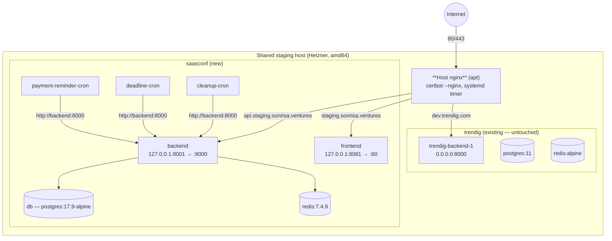

# MAIN-13468: Design

## Target runtime



Cron sidecars reach `http://backend:8000` **inside the Compose network**, so the
loopback host-port choice does not affect them.

## Port map

| Purpose | Host port | Container | Bound to |
|---|---|---|---|
| Public HTTP/HTTPS | 80 / 443 | host nginx | all interfaces |
| trendig backend | 8000 | 8000 | all interfaces (**not ours**) |
| saasconf backend | **8001** | 8000 | `127.0.0.1` |
| saasconf frontend | **8081** | 80 | `127.0.0.1` |
| saasconf db / redis | — | 5432 / 6379 | Compose network only |

## File layout

```
provision/
  ansible.cfg                              # copied from trendig
  inventory/
    staging.sonrisa.ventures.ini           # hosts
    domains/staging.ini                    # per-env vars (single source of truth)
  playbooks/
    saasconf.staging.provision.yml         # one-time host setup
    saasconf.staging.deploy.yml            # every deploy
    templates/
      docker-compose.j2
      nginx-saasconf.conf.j2
```

`ansible.cfg` uses `inventory = inventory` and `roles_path = roles` (relative),
so playbooks run with `ANSIBLE_CONFIG=$GITHUB_WORKSPACE/provision/ansible.cfg`
and `cwd: provision/`, exactly as Trendig's `deploy.yml` does.

> **Gotcha (verified 2026-07-09).** The `inventory = inventory` line is inert:
> Ansible's *directory* inventory scanner skips `.ini` files, because `.ini` is
> in the default `INVENTORY_IGNORE_EXTS`. Relying on it yields
> `No inventory was parsed, only implicit localhost is available`. Both inventory
> files must therefore be passed **explicitly**, which is also what Trendig's
> `deploy.yml` does:
>
> ```bash
> ansible-playbook \
>   -i inventory/staging.sonrisa.ventures.ini \
>   -i inventory/domains/staging.ini \
>   playbooks/saasconf.staging.deploy.yml
> ```
>
> Vars land on the host via the `[STAGING:vars]` group block in
> `domains/staging.ini`, merged with the `[STAGING]` host block in the other
> file. Confirmed with `ansible-inventory --host 49.13.59.187`.

### `inventory/domains/staging.ini`

```ini
[staging:vars]
domain=staging.sonrisa.ventures
api_domain=api.staging.sonrisa.ventures
vite_api_url=https://api.staging.sonrisa.ventures
backend_port=8001
frontend_port=8081
image_tag=staging
app_root=/home/deploy/saasconf
```

Consumed twice:
- **CI** — `grep '^vite_api_url=' … | cut -d= -f2-` → `--build-arg VITE_API_URL=…`
- **Ansible** — inventory vars → `{{ domain }}`, `{{ backend_port }}` in templates

## Compose changes (`docker-compose.j2`)

Derived from `deploy/staging/docker-compose.yml`:

- **Remove** the `nginx` service (lines 133-155) and the `certbot` service
  (lines 210-219). Host nginx replaces both.
- **`backend`** — drop `build:`, use
  `image: ghcr.io/pepediaz/saasconf-backend:{{ image_tag }}`, add
  `ports: ["127.0.0.1:{{ backend_port }}:8000"]`.
- **`frontend`** — drop `build:` (and its `target: prebuilt`), use
  `image: ghcr.io/pepediaz/saasconf-frontend:{{ image_tag }}`, add
  `ports: ["127.0.0.1:{{ frontend_port }}:80"]`.
- `db`, `redis`, and the three cron sidecars unchanged.
- Keep `postgres:17.9-alpine` pinned by digest.

Env resolution is unchanged: the file has no `env_file:` directive and relies on
`${VAR}` interpolation from `/home/deploy/saasconf/.env`.

## Host nginx vhost (`nginx-saasconf.conf.j2`)

Adapted from `deploy/staging/nginx.conf`, with upstreams retargeted from Docker
service names to loopback:

```
backend:8000  →  127.0.0.1:{{ backend_port }}
frontend:80   →  127.0.0.1:{{ frontend_port }}
```

Installed at `/etc/nginx/sites-available/saasconf`, symlinked into
`sites-enabled/`. `nginx -t` gates every reload — a syntax error here takes
`dev.trendig.com` down with it.

The source file was a **whole `nginx.conf`** (it configured a container). A site
file is `include`d inside the host's `http { }`, so `worker_processes`, `events`,
and `http` are dropped and only http/server-context directives survive.

### Findings from the live host (verified 2026-07-09)

- **`limit_req_zone` names are global.** Renamed `api` → `saasconf_api`. A bare
  `api` collides with any other site's zone and fails `nginx -t` **for the entire
  server**, not just our vhost. Verified: our namespaced zone coexists with a
  foreign `api` zone; the un-namespaced one would emit `duplicate zone`.
- **Bootstrap vhost required.** The real vhost references
  `/etc/letsencrypt/live/{{ domain }}/fullchain.pem`; before the first issuance
  `nginx -t` dies with `[emerg] cannot load certificate … no such file`, which
  also blocks reloads for `dev.trendig.com`. So: install
  `nginx-saasconf-bootstrap.conf.j2` (HTTP-only, ACME challenge) → reload →
  obtain cert → install the real vhost → reload.
- **Use `certbot certonly`, not `certbot --nginx`.** The existing
  `dev.trendig.com` file carries `# managed by Certbot` markers — the nginx
  plugin rewrites files in place. Our vhost is templated, so every render would
  clobber those edits. `certonly` leaves the config to us. Renewal needs
  `--deploy-hook "systemctl reload nginx"`.
- **One certificate, three SANs** (`{{ domain }}`, `{{ domain_www }}`,
  `{{ api_domain }}`), so both server blocks reference the `{{ domain }}` path.
  `www` must be a SAN or it serves a name mismatch.
- **`sites-enabled/` is inconsistent** on the host: `dev.trendig.com` is a
  regular file, `devtrendig.bjvsoft.net` a symlink. We use the symlink.

### Pre-existing bug fixed in passing

`add_header` does not merge across levels: **any** `add_header` in a `location`
discards every `add_header` inherited from the `server` block. The original
config set `Cache-Control`/`Pragma` inside
`location ~* ^/(index\.html|theme-init\.js)$`, silently dropping CSP, HSTS, and
the rest **on the SPA entry point** — the one document where CSP matters most.
The headers are now repeated in that location and in `/assets/`.

## Provision playbook (one-time)

1. `deploy` user in the `docker` group; `{{ app_root }}` owned by it
2. 2 GB swap if absent (WeasyPrint PDF generation at runtime)
3. `docker login ghcr.io` with `GHCR_READ_TOKEN`
4. Render + install the nginx vhost, `nginx -t`, reload
5. `certbot --nginx -d {{ domain }} -d {{ api_domain }}` — joins the existing
   systemd renewal timer
6. Assert `.env` exists at `{{ app_root }}/.env`, mode `0600` (never templated —
   placed by hand, holds `PII_ENCRYPTION_KEY`)

## Deploy playbook (every deploy)

Mirrors `trendig.staging.lux.deploy.yml`:

```yaml
- Login to ghcr (docker login --password-stdin)
- community.docker.docker_image: pull backend + frontend at :{{ image_tag }}
- template: docker-compose.j2 → {{ app_root }}/docker-compose.yml
- community.docker.docker_compose_v2: up db, redis (wait)
- shell: docker compose run --rm --no-deps backend alembic upgrade head
- community.docker.docker_compose_v2: state=present, recreate=always
- shell: docker image prune -a --force --filter "until=1h"
```

Migrations run **from the pulled backend image** — `Dockerfile.prod` bundles
`alembic.ini`, `app/`, and `scripts/`, so no source lives on the server.

## CI changes (`staging.yml`)

**Removed:** `Ensure swap`, `Reclaim docker disk space`, `Deploy backend source`,
`Deploy configuration`, `Deploy frontend dist`, `Build frontend image on
staging`, `Build backend image on staging`, `Tag previous images for rollback`,
**`Reset database for PG16 (one-time fix)`**, `Rebuild and restart containers`.

**Added:** ghcr login (`permissions: packages: write`, runner `GITHUB_TOKEN`),
buildx build+push for both images, then:

```yaml
- run: pip install 'ansible==9.*'
- run: ansible-galaxy collection install community.docker
- run: ansible-playbook -i inventory/staging.sonrisa.ventures.ini playbooks/saasconf.staging.deploy.yml
  working-directory: provision
  env:
    ANSIBLE_CONFIG: ${{ github.workspace }}/provision/ansible.cfg
    GHCR_READ_TOKEN: ${{ secrets.GHCR_READ_TOKEN }}
    GHCR_READ_USER: ${{ github.repository_owner }}
```

Health check and E2E stay as-is. Rollback becomes `image_tag=<sha>` + re-run.

## Deploying from a topic branch

Requirement: this migration must be exercisable against the new host **before it
merges**.

`workflow_dispatch` requires a workflow to exist on the **default branch** to be
dispatchable at all — but once it does, dispatching with a `--ref` runs *that
ref's* version of the file, and `staging.yml`'s checkout step
(`ref: ${{ inputs.tag || github.sha }}`) checks out that branch's code. Precedent:
run `29014651139` was dispatched from `release/v0.16.0`, not `main`.

```bash
gh workflow run staging.yml --ref chore/staging-server-migration
```

Two consequences for this change:

- **Keep the filename `staging.yml`.** Introducing a new workflow file would make
  it undispatchable until merged (`HTTP 404: workflow … not found on the default
  branch` — observed with `get-staging-env.yml`).
- `deploy-staging` is gated by `needs: verify`, so every dispatch runs the full
  suite first. If that is too slow while iterating, drop the gate *temporarily*
  and **restore it before merge** — CI must gate the merge.

## Registry credentials on the shared host

Docker stores **one credential per registry per config file**. The Trendig stack
is already logged in to `ghcr.io` as `TrendigGmbH` in `/root/.docker/config.json`
(its playbook runs `become: yes`). Our provision play also runs as root, so a
plain `docker login ghcr.io` would **overwrite that credential** and Trendig's
next `docker compose pull` would 401.

Mitigation: every SaaSConf play sets

```yaml
environment:
  DOCKER_CONFIG: "{{ app_root }}/.docker"
```

so we get an isolated credential store regardless of which user a task runs as.
The provision playbook additionally checksums `/root/.docker/config.json` before
and after the login and **fails the play** if it changed.

Images are pulled with the `docker` CLI rather than
`community.docker.docker_image`: the CLI honours `DOCKER_CONFIG` deterministically,
whereas the Python SDK's config resolution is less predictable — and getting it
wrong means silently authenticating as `TrendigGmbH`.

## Data migration

1. `restore.sh` (or `pg_restore`) the verified `db_20260709_120936.sql.gz` into
   the fresh `postgres:17.9-alpine` volume. **Major version must match.**
2. Verify through host nginx with an `/etc/hosts` override pointing
   `staging.sonrisa.ventures` at the new IP — no public DNS change yet.
3. **Log in.** A successful login proves `PII_ENCRYPTION_KEY` was carried over
   intact; encrypted PII columns are otherwise unrecoverable.
4. Redis is disposable — it rebuilds.

## Temporary domain, then cutover

The stack is stood up and verified on a **temporary public hostname** on the new
box, so verification exercises real DNS and real TLS rather than an `/etc/hosts`
override. `staging.sonrisa.ventures` is not touched until the box is proven.

| Host | Type | Value | Serves |
|---|---|---|---|
| `devsaasconf.bjvsoft.net` | A | `49.13.59.187` | frontend |
| `www.devsaasconf.bjvsoft.net` | CNAME | `devsaasconf.bjvsoft.net` | frontend |
| `api.devsaasconf.bjvsoft.net` | A | `49.13.59.187` | backend |

All three resolve (verified against `8.8.8.8` and `1.1.1.1`; NS is GoDaddy
`ns23/ns24.domaincontrol.com`). The nginx vhost must carry **both** frontend
names in `server_name`, and certbot needs a `-d` for each, or `www` serves a
cert-name mismatch.

**Cutover is not a DNS change alone.** `VITE_API_URL` is baked into the JS bundle
at build time, so the frontend image is permanently wired to whichever API host
it was built against. Switching to the real domain means:

1. Swap `domain` / `api_domain` / `vite_api_url` in `domains/staging.ini`
   (real values are kept as comments in that file).
2. **Rebuild + push the frontend image.** The backend image is runtime-configured
   and carries over untouched.
3. `certbot --nginx` for `staging.` + `api.staging.sonrisa.ventures`.
4. Repoint both A records off `46.225.88.254` (registrar: united-domains, NS
   `ns.udag.{net,org,de}`; lower TTL a day ahead).
5. Update the `STAGING_HOST` Actions secret.
6. Keep the old box up for a rollback window.

While on the temp domain, `FRONTEND_BASE_URL` and `PORTAL_BASE_URL` in the
server's `.env` must point at `devsaasconf.bjvsoft.net` — they build the links in
outbound email, and pointing them at the old, cert-expired box would send users
to a browser warning.

## Secrets

| Secret | Purpose | Who |
|---|---|---|
| `GHCR_READ_TOKEN` | server pulls private images | new |
| `STAGING_HOST` | new IP, at cutover | existing |
| `STAGING_SSH_KEY` | public half → new box `authorized_keys` | existing |

## Alternatives considered

- **Plain ssh + ghcr, no Ansible.** Delivers the same runtime wins (the build
  move is what removes swap/prune/rsync). Rejected: no provisioning story on a
  fresh host, and the user wants parity with Trendig.
- **Runtime-configurable `VITE_API_URL`** via `window.__ENV__` + a rendered
  `/config.js`. Would collapse staging/production to one frontend image.
  Rejected as scope creep; revisit separately.
- **Lift-and-shift the containerised nginx/certbot.** Impossible — host nginx
  already binds 80/443.
